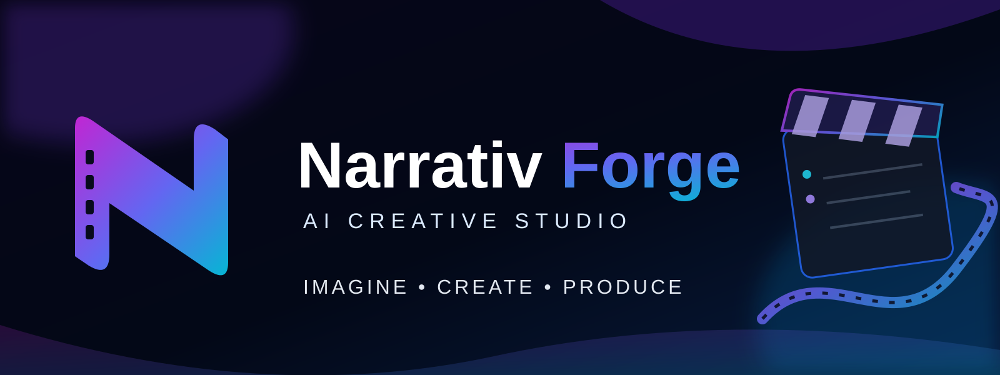

# 👋 Hello, I'm Narrativ Forge

  
  
  

I build **AI-powered creative tools** that bring stories, visuals, sound, and production workflows together.

My main project is **Narrativ Forge** — an evolving multimedia narrative studio designed to help creators move from an idea to a structured, reviewable production workflow.

> **တီထွင်ဖန်တီးမှုနဲ့ နည်းပညာကို ပေါင်းစပ်ပြီး ဇာတ်လမ်းတွေကို ပိုမိုအသက်ဝင်လာစေဖို့ တည်ဆောက်နေပါတယ်။**

---

## 🚀 Featured project

### 🎬 [Narrativ Forge](https://github.com/narrativforge/Narrativ-Forge)

An AI-assisted multimedia narrative and production platform.

- **Story development** — turn concepts into structured scenes and story material.
- **Visual production workflows** — organize storyboards, media assets, and creative iterations.
- **Audio workflows** — support speech, transcription, and voice-related production tasks.
- **Production orchestration** — connect the web studio, backend services, media infrastructure, and Telegram workflows.
- **Human-in-the-loop review** — keep creative decisions and final approvals with the creator.

**Project stack**  
 
 
 
 

[**Explore the repository →**](https://github.com/narrativforge/Narrativ-Forge)

---

## 🧭 What I'm focused on

| Area | Direction |
|---|---|
| AI & creative systems | Practical AI-assisted storytelling and media workflows |
| Full-stack engineering | Connecting frontend experiences with reliable backend services |
| Automation | Making multi-step creative workflows easier to operate |
| Product quality | Clear architecture, maintainability, security, and production readiness |

## 🛠️ Technologies

  

## 📌 Current project

**Narrativ Forge is actively evolving.** The repository is the source of truth for its current implementation, setup instructions, and supported capabilities. Features and integrations may change as development progresses.

- Main codebase: [narrativforge/Narrativ-Forge](https://github.com/narrativforge/Narrativ-Forge)
- Profile and project hub: [narrativforge/narrativforge](https://github.com/narrativforge/narrativforge)

## 🤝 Connect

For questions, ideas, bug reports, or collaboration, please open a discussion or issue in the [main repository](https://github.com/narrativforge/Narrativ-Forge).

---

  <i>Building thoughtful tools for better stories.</i> 
  Made with curiosity, persistence, and a little help from AI.

